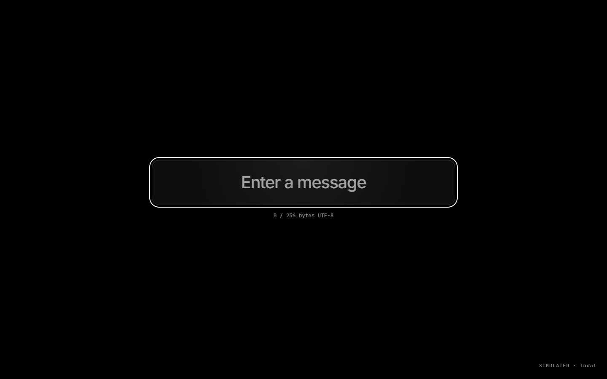
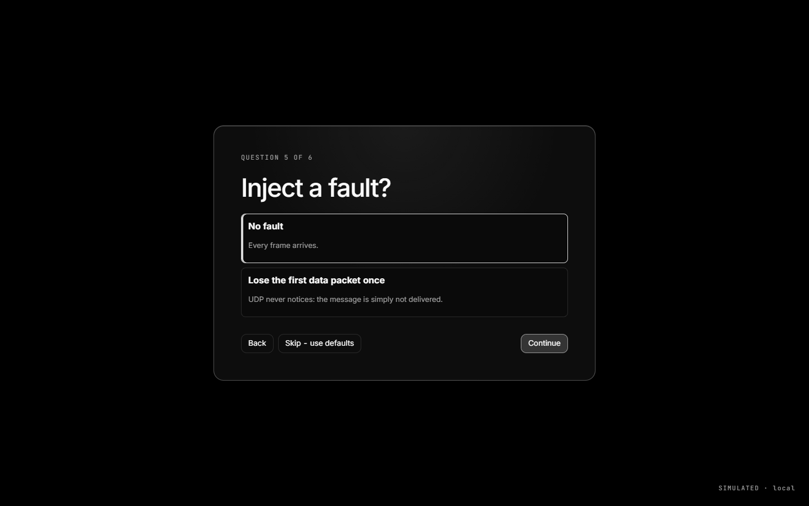
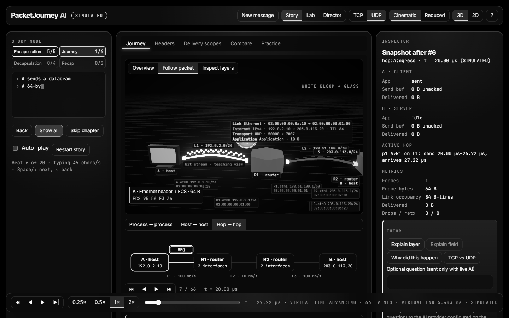
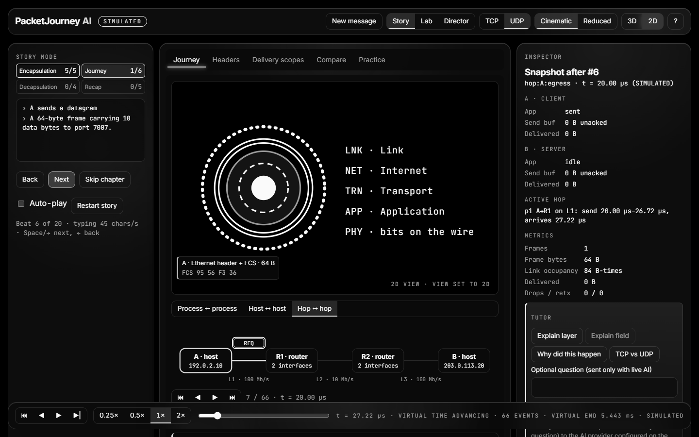

# PacketJourney AI

A local, educational TCP/IP visualizer. Everything shown is **SIMULATED** — the browser opens no real sockets and captures no traffic.

The interface is monochrome liquid glass (`docs/DESIGN_V2.md`): it opens on a single message field, asks the Story questions one at a time, boots from the run's real values and turns your message into the packet. Lab, Compare, Practice, Tutor and Director stay one click away; **Alt+D** on the entry screen starts Director.

| Entry | Questions | Journey (3D) | Journey (2D fallback) |
|---|---|---|---|
|  |  |  |  |

## Start locally

Prerequisite: Node.js 22 or newer, including npm. PostgreSQL, Docker, Firebase and Python are not used.

### Windows PowerShell

```powershell
node --version
npm --version
if ([int]((node --version).TrimStart('v').Split('.')[0]) -lt 22) { throw 'PacketJourney requires Node.js 22 or newer.' }
npm ci
npm run dev
```

### macOS / Linux

```sh
node --version
npm --version
node -e "if (+process.versions.node.split('.')[0] < 22) throw Error('PacketJourney requires Node.js 22 or newer')"
npm ci
npm run dev
```

Open <http://127.0.0.1:5173>. The scripts start the optional local server on `127.0.0.1:8787` and Vite on `127.0.0.1:5173`. After `npm ci` has installed dependencies, the core visualizer, saved scenarios, presets and Director mode need no internet.

The AI tutor is optional. Without AI configuration, or without the local server, built-in explanations and every core simulation still work. To run only the offline-capable web app:

```sh
npm run dev:web
```

To opt into a live provider, copy `.env.example` to `.env` and fill the server-only values described there. Never put a provider key in a scenario JSON or a `VITE_` variable.

For browser verification, install Chromium once while online:

```sh
npx playwright install chromium
npm run verify
```

## Scripts

| Script | Does |
|---|---|
| `dev` | server + web dev servers |
| `build` | production build of web |
| `typecheck` | `tsc` across shared, server, web, e2e |
| `lint` | ESLint |
| `test` | Vitest unit tests |
| `test:e2e` | Playwright (run `npx playwright install chromium` once) |
| `verify` | all of the above + secret scan |

## Local scenario files

Lab → **Save & present** can export/import a versioned JSON scenario, load the eight named presets, start Director mode, print the current run summary, or reset local demo data. Imports are size- and schema-checked; saved event lists are never accepted. Deterministic examples live in `examples/`.

## Docs

`docs/SPEC.md` · `docs/PROTOCOL_MODEL.md` · `docs/DESIGN_V2.md` (supersedes the visuals in `docs/EXPERIENCE.md`) · `docs/DEMO_SCRIPT.md` · `docs/VIVA.md` · `docs/STATUS.md` · `docs/DECISIONS.md` · `docs/TEST_EVIDENCE.md`
